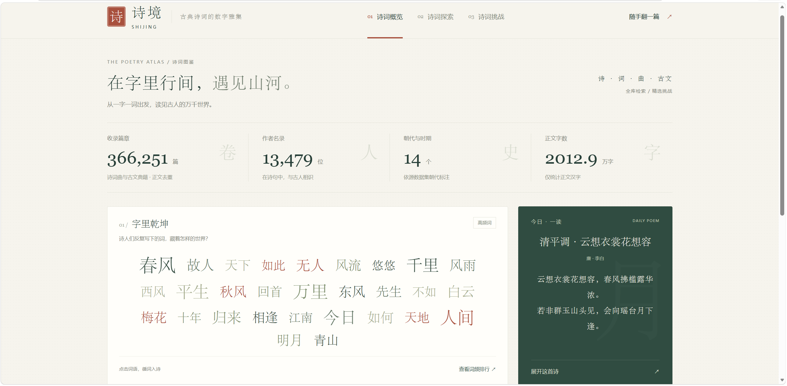
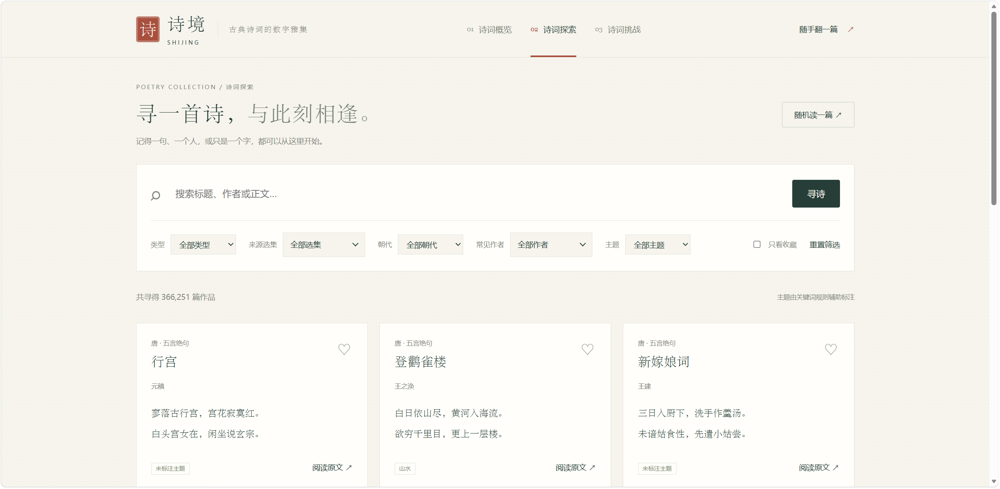
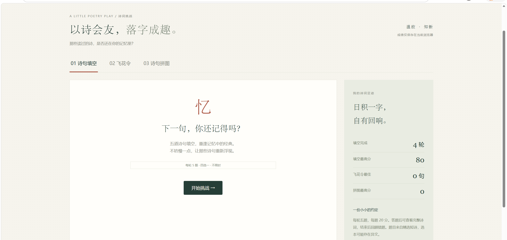

# 古诗 · 诗境——古诗词探索与互动学习平台

Python / Flask 后端，HTML + CSS + 原生 JavaScript 前端，ECharts 图表。三个页面：诗词概览、诗词探索、诗词挑战。无需 API Key，首次准备好依赖和数据后可离线运行。

## 下载完整项目（含全部数据库）

**需要完整的 366,251 篇数据，请下载 [完整项目压缩包 gushi-full-v1.0.0.zip](https://github.com/gongdan255/gushi/releases/download/v1.0.0-full/gushi-full-v1.0.0.zip)。**

[完整版本发布页与 SHA-256 校验文件](https://github.com/gongdan255/gushi/releases/tag/v1.0.0-full)

完整包包含网站源码、前端资源、README 截图、精选题库、来源与许可说明，以及 `data/corpus.sqlite3` 完整数据库（解压后约 1.36 GB）。解压后按下方“启动”步骤安装 Python 依赖即可运行，无需重新下载或导入诗词数据。Python 解释器和依赖需另行安装。

GitHub 的绿色 **Code → Download ZIP** 和发布页自动生成的 **Source code** 仅下载 Git 源码，不包含完整数据库；它们保留 527 首精选作品和全量数据重建脚本。请在参赛交付或完整体验时选择上面的 `gushi-full-v1.0.0.zip`。

## 界面展示

### 诗词概览：从数据走近古典文学

首页集中展示收录篇章、作者名录、朝代与时期、正文字数等信息，通过高频词云和“今日一读”提供阅读入口。点击词云可检索相关作品；页面下方的“诗中四季”和“意象共现图”支持从季节字与共现关系探索诗词。



*截图中的 366,251 篇为当前版本去重后的正文记录，包含诗词曲与古文典籍；组诗、典籍章节按来源记录计数。*

### 诗词探索：多条件联动检索与卡片阅读

支持按标题、作者或正文搜索，并按“类型 → 来源选集 → 朝代 → 常见作者 → 主题”逐级筛选。后续选项随前面的条件变化，仅显示对应数据中的有效选项；来源选集和常见作者支持下拉搜索。作品以卡片展示，可收藏、打开完整原文、对照原始选本并追溯出处。



### 诗词挑战：在互动中温习经典

挑战页包含“诗句填空”“飞花令”和“诗句拼图”三种玩法。截图展示诗句填空入口，每轮五题，答题后可查看原文并回顾错题。飞花令支持预设令字、自由选字及关联词语浏览；诗句拼图通过排列四句短诗帮助温习原诗顺序，并支持错题重练。右侧展示当前浏览器保存的挑战记录与玩法说明。



*截图中的成绩为演示时的本地记录，不是全站排行榜。*

## 启动

建议 Python 3.11，在项目根目录执行：

```powershell
python -m venv .venv
.\.venv\Scripts\python.exe -m pip install -r requirements.txt
.\.venv\Scripts\python.exe app.py
```

打开 http://127.0.0.1:5180 。默认绑定本机，不对公网开放；服务由 Waitress 提供。也可以使用已安装好依赖的 Python 执行 `python app.py`。

## 功能

- 概览：真实语料数量、分词词云和词频排行、诗中四季、意象共现图、意象字覆盖率及图表点击检索。
- 探索：标题/正文/作者搜索，朝代/作者/主题筛选，分页，原文对照，来源追溯，随机遇诗，TF-IDF 字符一元/二元相似推荐。
- 收藏：仅保存在当前浏览器 localStorage，无登录、无跨设备同步。
- 填空：每轮 5 题，每题 20 分，四选一，作答反馈，答题回顾与原文链接。
- 飞花令：指定字、练习/60 秒限时、繁简体规范化、整句与连续诗句匹配、重复答案检查、出处回溯。
- 诗句拼图：每轮 5 首精选的四句短诗，点击排序、撤回、重排，提交后核对原文，每题 20 分；支持错题重练，练习不计入最高分。
- 成绩：当前浏览器保存轮数、最高分，不作为防作弊竞赛排名。

## 数据与限制

支持唐诗、宋诗、宋词，以及《诗经》《楚辞》、元曲、花间集、南唐二主词、曹操诗集、纳兰词、御定全唐诗、水墨唐诗和蒙学选本；同时收录《论语》《孟子》《大学》《中庸》《幽梦影》与古文典籍。另保留两部经典选本的 527 首作品用于精选挑战。诗词曲与古文典籍可分别筛选；总量按来源篇章记录统计，组诗、章节不等同于单首诗。实际规模见首页和 `data/remaining_provenance.json`。原始来源：
https://github.com/chinese-poetry/chinese-poetry

精选本的具体 commit、文件与处理步骤见 `data/provenance.json`；扩展库见 `data/full_provenance.json`，固定使用同一个 commit。下载缓存保存在 `data/upstream/<commit>/`，MIT 许可保存在 data 目录。图表库及其许可保存在 static/vendor。构建后启动不需要联网。

本次完整导入结果：366,251 篇正文记录（诗词曲 365,692，古文典籍 559），覆盖 32 个选集；在原有 330,663 篇基础上新增 35,588 篇。新增处理 941 个 JSON 文件，其中作者与选集简介另存为元数据，其余正文经过规范化去重。各选集成员数量存在重叠，不应相加作为总量。

扩展库使用 SQLite，只读连接按请求打开；作者、朝代、选集、飞花令诗句建立索引，三字及以上纯汉字查询使用 FTS5 trigram 索引，短词使用字面扫描。统计和分词在导入时完成。相似推荐在同作者与意象候选池内计算 TF-IDF，不在启动时拟合几十万首作品。作者下拉框显示收录量前 200 位，其他作者可通过搜索框查询。

导入过程展开组诗，将繁体转换为简体，移除分析文本中的括号异文注记，以规范化正文去重，保留原始段落供对照。不同作者别名尚未全部归并，朝代和作者沿用选本标注。源数据可包含错字、归属错误或版本差异，参赛前需要进一步人工校勘，不应将本库当作权威校注本。程序未生成译文、赏析或伪造文学解读。

主题采用公开写在 app.py 的关键词规则，页面注明辅助标注，不能作为人工金标准。分词使用 jieba，古文适配有限；意象按字符覆盖统计。排行榜是本库收录分布，不能推断作者创作总量。飞花令严格匹配当前语料，未命中可能只是未收录。填空题目前从格式完整的短诗自动生成，尚非人工逐题审定。

可按固定版本重建完整数据库（需要先有精选本及其 provenance）：

```powershell
python scripts/expand_corpus.py
python scripts/import_remaining.py
```

这会下载固定版本分片并重建 `data/corpus.sqlite3`，耗时数分钟至十几分钟，建议预留 4 GB 空间供缓存与临时库使用。下载可复用缓存；构建先写临时库，全部成功才替换。重建后需重启服务。精选本优先去重，既有收藏 ID 保留；新增选集使用多对多来源归属，同文去重后仍可通过新增选集查找，并在详情查看来源。原有唐宋分片保留其首次收录来源。新增导入涵盖固定版本所有其他文学正文 JSON，作者简介另存元数据，不把排行、格律标注和加载配置当作作品。`scripts/import_data.py` 仅更新小型精选本；若更新数据版本，应同步更新 `data/tree.json` 并重建扩展库。不要只运行第一条重建命令，否则会退回唐宋基础库。

完整 SQLite 数据库随上方 GitHub Release 完整包提供，不存入普通 Git 历史。原始下载缓存可按固定来源重新获取，不影响系统运行。缺少扩展库时仍可使用随项目保存的精选本；完整数据交付请选择完整包，或执行上面的构建命令。

## 验证

```powershell
python -m unittest discover -s tests -v
node --check static/app.js
```

测试覆盖真实统计口径、繁体搜索、筛选分页、空结果、相似推荐、题目选项与答案、飞花令繁简体、重复、拼接、虚构与异常请求。

## 参赛准备

补充人工校勘和意象标签审核；开展真实用户试用并记录改进；准备演示视频、技术说明、原始数据许可、第三方依赖及 AI 使用说明。本项目由 Codex 辅助编写，相关过程应按比赛要求如实披露。当前交付为本地可运行首版，不包含公开部署或比赛报名提交。

补漏核对：补入《唐诗补录》、全唐诗目录的《唐诗三百首》和《宋词三百首》，647 条源记录中新增 57 篇正文，其余保留选集归属。`python scripts/import_remaining.py --supplement` 可单独补入这三个文件。全量命令已包含它们。`全唐诗/error/` 为错误记录，`表面结构字.json` 为字符映射，作者文件为人物资料，均不作为新增诗词计数。
